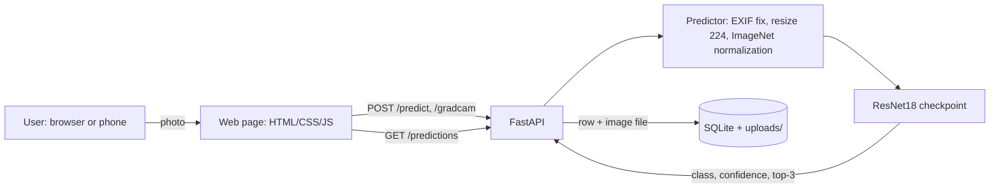
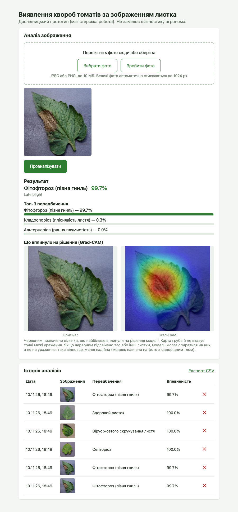

# Plant Disease Detection from Leaf Images

Master's thesis prototype: «Розробка інтелектуальної інформаційної системи виявлення захворювань сільськогосподарських культур на основі аналізу зображень».

A web system that accepts a plant-leaf photo, classifies the disease with a transfer-learned ResNet18 (PyTorch), returns the predicted class and confidence, and stores prediction history in SQLite.

**Status:** complete prototype: training, evaluation, REST API, web interface, SQLite history, Grad-CAM. Demo scenario: `docs/DEMO.md`.

## Features
- Transfer learning with ResNet18 (ImageNet weights)
- Reproducible training/evaluation (fixed seeds, YAML config)
- Metrics: accuracy, precision, recall, F1, confusion matrix
- FastAPI backend: `GET /health`, `POST /predict`, `POST /gradcam`, `GET /predictions`, `DELETE /predictions/{id}`, `GET /predictions.csv`
- Plain HTML/CSS/JS interface (Ukrainian), works on phones: camera button, drag and drop, large photos are downscaled in the browser, EXIF rotation handled, history with delete and CSV export
- Grad-CAM heatmap showing which regions influenced the prediction (`POST /gradcam`, button in the interface)

## Architecture

Screenshots (taken with test images from PlantVillage): `docs/img/ui_desktop.png`, `docs/img/ui_mobile.png`.



## Technology stack
Python, PyTorch, FastAPI, SQLite, HTML/CSS/vanilla JS.

Verified versions (fresh virtual environment built from `requirements.txt`, all tests pass): Python 3.9.6, torch 2.8.0, torchvision 0.23.0, fastapi 0.128.8. Development machine: MacBook Pro, Apple M2 Pro, 16 GB (PyTorch MPS backend).

## Dataset
PlantVillage (Hughes & Salathe), the 10 tomato classes, original colour images (`raw/color`) from the public GitHub repository `spMohanty/PlantVillage-Dataset`. Real class folder names (note the space in the spider-mite class):
`Tomato___Bacterial_spot`, `Tomato___Early_blight`, `Tomato___Late_blight`, `Tomato___Leaf_Mold`, `Tomato___Septoria_leaf_spot`, `Tomato___Spider_mites Two-spotted_spider_mite`, `Tomato___Target_Spot`, `Tomato___Tomato_Yellow_Leaf_Curl_Virus`, `Tomato___Tomato_mosaic_virus`, `Tomato___healthy`.

Download only the tomato folders (about 311 MB; the full repo is about 2 GB):
```bash
git clone --filter=blob:none --no-checkout --depth 1 https://github.com/spMohanty/PlantVillage-Dataset.git /tmp/pv
cd /tmp/pv && git sparse-checkout init --no-cone && git sparse-checkout set '/raw/color/Tomato___*/' && git checkout
mkdir -p <project>/data/raw/PlantVillage && cp -R /tmp/pv/raw/color/Tomato___* <project>/data/raw/PlantVillage/
```
The deterministic 70/15/15 stratified split (exact duplicates removed) is created by `src/data/split_dataset.py` and saved to `data/processed/split.json`. The dataset is never committed (`data/raw/` and `data/processed/` are git-ignored).

## Installation
```bash
python3 -m venv .venv
source .venv/bin/activate
pip install -r requirements.txt
cp config/config.example.yaml config/config.yaml
```

## Trained models
The trained weights are included: `models/checkpoints/baseline.pt` (used by the web application) and `models/checkpoints/augmented.pt` (experiment with augmentation). Training code: `src/training/train.py`, evaluation: `src/training/evaluate.py`, hyperparameters: `config/config.yaml`. Saved metrics: `results/metrics/`, figures: `results/figures/`, comparison: `results/reports/comparison.md`.

## Results
All numbers come from real runs (`results/metrics/*.json`, `results/reports/comparison.md`). Test set: 2 722 images that were never used for training or for choosing the checkpoint. Same split, seed 42, 10 epochs, Adam, lr 0.001; the checkpoint with the best validation accuracy is kept.

| run | augmentation | best epoch | test accuracy | macro precision | macro recall | macro F1 | weighted F1 |
|---|---|---|---|---|---|---|---|
| baseline | no | 7 | 0.9868 | 0.9813 | 0.9850 | 0.9830 | 0.9868 |
| augmented | yes | 10 | 0.9827 | 0.9741 | 0.9803 | 0.9769 | 0.9827 |

Augmentation did not improve the test metrics in this experiment (11 more errors out of 2 722). It is a single run with a single seed, so the difference is not claimed to be significant. Figures: `results/figures/` (loss and accuracy curves, confusion matrices, comparison). Metrics on photos from other sources were not measured.

## Reproducibility
Seeds for Python, NumPy and PyTorch are fixed (`seed` in the config), the split is saved once and is deterministic. Check performed: the baseline was trained a second time from scratch (run `repro`): all 10 epochs (train/validation loss and accuracy) and all test metrics, including the confusion matrix, were identical to the first run (`results/metrics/repro_*.json`). This was verified on the same machine and software versions; bit-identical results on other hardware (CUDA, CPU) are not guaranteed.

## Inference (Python)
```python
from src.inference.predictor import Predictor
Predictor().predict("path/to/leaf.jpg", top_k=3)
```
Uses the checkpoint from `model.checkpoint_path` in the config.

## Grad-CAM
Code: `src/visualization/gradcam.py`; in the web interface and via `POST /gradcam`. The heatmap is coarse (7x7 cells scaled up): it shows the general area the model relied on, not exact lesion borders.

## Running the API
```bash
./run.sh                 # same as: python -m uvicorn src.api.main:app --port 8000
```
Web interface: http://127.0.0.1:8000/ (upload a leaf image, press the button, see the result and history). Interactive API docs: http://127.0.0.1:8000/docs. The trained checkpoint (`model.checkpoint_path`) must exist; otherwise `/health` reports `model_loaded: false` and `/predict` returns 503.

## Using it from a phone
```bash
./run.sh --lan           # prints http://<IP-of-the-Mac>:8000/
```
Phone and Mac must be on the same Wi-Fi. The server then listens on all network interfaces and has no authentication: use it for demonstrations only. The "Зробити фото" button opens the phone camera (`<input type="file" capture>`), so no HTTPS is needed. Large photos are downscaled to 1024 px in the browser; the server also applies the EXIF rotation flag, which phones set on portrait photos.
Checked with automated Chrome (desktop and a 390 px wide phone layout, a 3000x2000 JPEG with an EXIF rotation flag, the camera input element, drag and drop). Not checked on a real phone (Safari on iPhone, HEIC photos, the macOS firewall prompt).

## Example API request
```bash
curl http://127.0.0.1:8000/health
curl -F "file=@path/to/leaf.jpg;type=image/jpeg" http://127.0.0.1:8000/predict
curl -F "file=@path/to/leaf.jpg;type=image/jpeg" -o heatmap.png http://127.0.0.1:8000/gradcam
curl "http://127.0.0.1:8000/predictions?limit=10"   # prediction history, newest first
curl -X DELETE http://127.0.0.1:8000/predictions/1   # delete one history item and its image
curl -o history.csv http://127.0.0.1:8000/predictions.csv   # whole history as CSV
```
Every accepted upload is saved in `uploads/` (random file name) and logged in the SQLite database `data/predictions.db` (both git-ignored). Accepted: JPEG/PNG up to 10 MB (`api.max_upload_mb`). Errors: 415 wrong type, 413 too large, 400 unreadable/empty, 503 model missing.

## Tests
```bash
python -m pytest tests -q
```

## Project structure
- `config/` – YAML configuration
- `data/` – raw and processed dataset (not committed)
- `models/checkpoints/` – trained weights (`baseline.pt`, `augmented.pt`)
- `src/` – data, training, models, inference, visualization, api code
- `web/` – frontend (HTML/CSS/JS)
- `tests/` – automated tests
- `results/` – figures, metrics, reports
- `docs/` – demo scenario (`DEMO.md`), screenshots (`img/`)
- `run.sh` – starts the web application (`--lan` for access from a phone)

## Limitations
- PlantVillage images are largely collected under controlled conditions; real-world field performance may be lower.
- Accuracy was measured only on the PlantVillage test split. On photos from other sources it has NOT been measured; the confidence shown in the interface is a softmax probability, not accuracy. The interface warns when the confidence is below 80 %: on the PlantVillage test set 55 of 2 722 images (2.0 %) were below this value and only 60.0 % of them were classified correctly, versus 99.5 % for the rest (this relation was measured on PlantVillage only).
- Grad-CAM on field photos (greenhouse, complex background) often highlights the background or neighbouring leaves instead of the lesion. This is consistent with the model relying partly on background cues of PlantVillage (uniform lab background); the interface warns about it. Not measured quantitatively on labelled field images.
- The model has no "not a leaf" class: it always outputs one of the 10 tomato classes, sometimes with high confidence even for unrelated images (observed on blank/noise test images). Confidence is a softmax probability, not a guarantee of correctness.
- The Ukrainian disease names in the interface are the author's translation; check the terminology before using it in the thesis.
- This is a research/prototype tool, not a substitute for professional agronomic diagnosis.
